# da-learn-21 · E-commerce web analytics (GA4 Google Merchandise Store)

A data-analyst learning project on real **Google Analytics 4 event data** from the **Google Merchandise Store**. The source is Google's public, obfuscated BigQuery sample `ga4_obfuscated_sample_ecommerce`, covering 1 Nov 2020 to 31 Jan 2021: **4,295,584 events from 270,154 users in 360,129 sessions, with 4,887 transactions and $339,343 revenue**. The project rebuilds sessions from raw events and analyses traffic sources, the checkout funnel, conversion, devices, engagement/bounce, timing and revenue. The pipeline runs through SQL staging, cleaning (types, standardisation, dedupe, placeholder handling, purchase de-duplication, outlier and integrity flags), a star schema, KPI analysis and quality checks. DuckDB runs the whole pipeline locally on the **full** 1.84 GB export in about 20 s. The outputs are a Power BI kit plus SVG and PNG charts in `results/images/`.

> **Databricks was skipped** for this project because the Databricks workspace hit its resource quota. There is no live Lakeview dashboard. The SQL stays Databricks/Spark-compatible (the DuckDB shims are isolated in `sql/00`), and all charts and KPIs are in [`results/`](results/RESULTS.md).

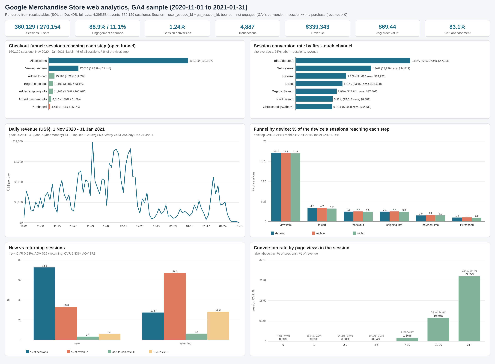

## Business questions
1. How much traffic does the store get, how engaged is it (engagement and bounce rate), and what share of sessions converts?
2. Where does the checkout funnel leak: view item → add to cart → begin checkout → shipping → payment → purchase?
3. Which acquisition channels and session sources bring traffic, and which bring revenue (CVR, AOV, revenue per session)?
4. Do devices differ in engagement, funnel progression and conversion?
5. When do people buy: daily trend, Black Friday/Cyber Monday, the December peak, the holidays, and weekday × hour?
6. Which countries and landing pages convert, and how do new and returning visitors differ?
7. How does engagement depth (page views) relate to conversion, and what do order values look like?
8. How clean is the raw export (header repeats, duplicate purchases, missing ids, obfuscation placeholders), and what had to be fixed?

## Pipeline
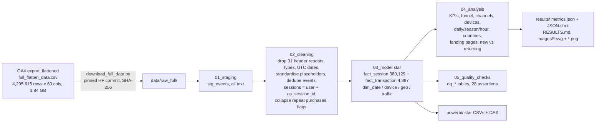

## Headline insights (full data, 1 Nov 2020 to 31 Jan 2021)
1. **1.24% of sessions convert, and the biggest leak is before the cart.** Only **21.4%** of sessions view a product and 19.7% of those add to cart. Of cart sessions, 73.1% begin checkout, and 65.2% of sessions that reach payment buy. Cart abandonment is **83.1%** and checkout abandonment 60.0%. Engagement is 88.9%, so bounce rate is 11.1%.
2. **The holiday season drives revenue.** December 1-23 earned **$6,423/day** (CVR 1.70%) and Black Friday to Cyber Monday $7,051/day (CVR 2.10%, highest AOV at $82.46), against $2,700/day on regular days and $1,354/day over Christmas to New Year. **Cyber Monday (30 Nov) was the best day at $11,910.** Monthly revenue: Nov $123,507, Dec $158,956, Jan $56,880.
3. **Returning visitors are 27.5% of sessions but 67.0% of revenue.** They convert at 2.83% vs 0.63% for new users and spend $72.15 vs $64.53 per order. Sessions with 21+ page views are 2.5% of traffic but bring **70.4% of revenue** (CVR 29.7%).
4. **Organic search brings the volume, referrals convert.** First-touch Organic Search has 34.1% of sessions and 28.8% of revenue (CVR 1.02%); Paid Search has the lowest CVR (0.92%) and AOV ($58.53). On session-scoped source/medium, Referral converts at **3.56%** ($2.65 per session). The 26.3% of sessions with no session source almost never buy (1 conversion).
5. **Device barely matters.** Desktop has 58.0% of sessions and 58.0% of revenue, mobile 39.8% and 40.2%. Mobile CVR (1.27%) is in fact slightly above desktop (1.21%). The US is 43.9% of sessions and 44.3% of revenue; Canada has the highest AOV of the top 3 countries ($77.41).
6. **Home is the money landing page.** Sessions landing on Home (102,934) convert at 2.25% and bring 51.7% of revenue, while the viral Google Dino Game Tee page (18,450 landings) converts at 0.02%.

Full tables, all insights and the data-quality evidence are in [`results/RESULTS.md`](results/RESULTS.md).

## Charts
All charts are in `results/images/` as SVG (plain vector shapes, no embedded raster) and PNG (2× headless-Chrome render of the same SVG).

| | |
|---|---|
| 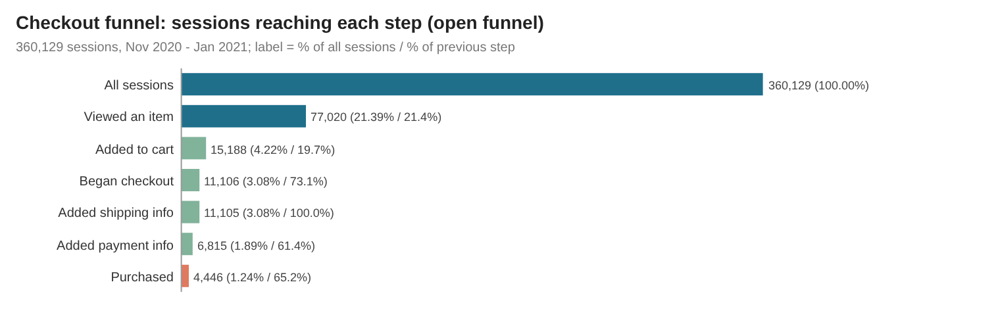 | 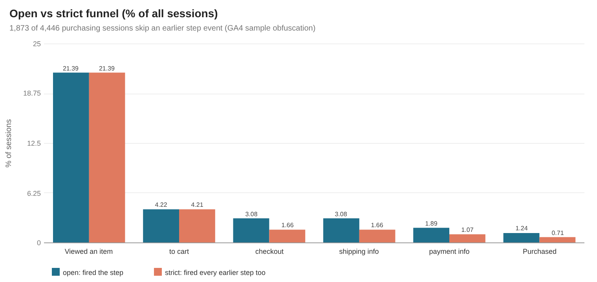 |
| 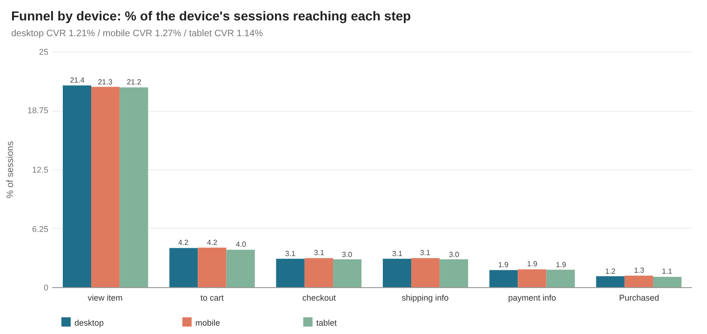 | 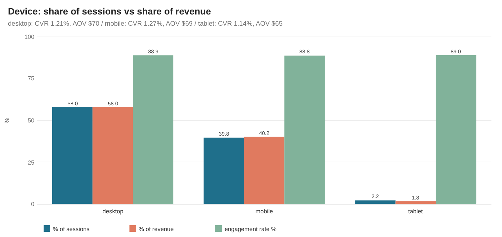 |
| 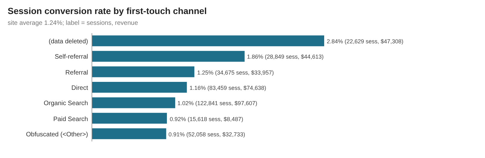 | 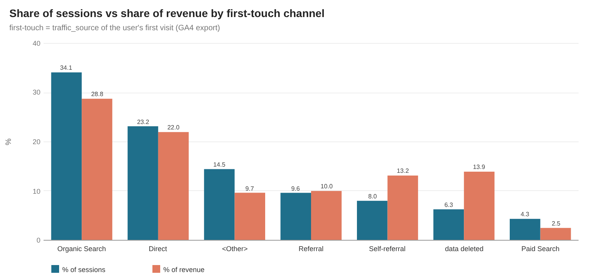 |
| 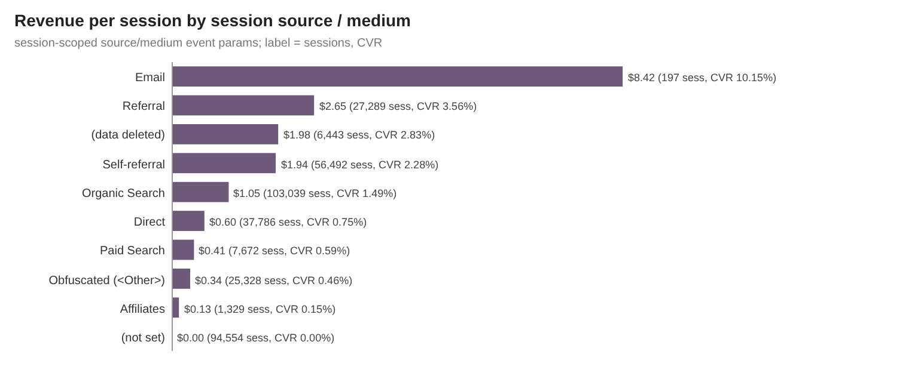 | 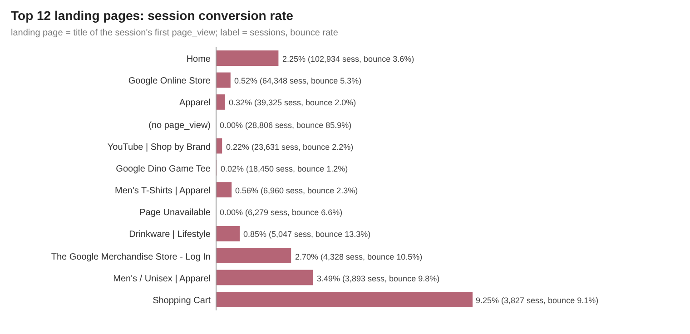 |
| 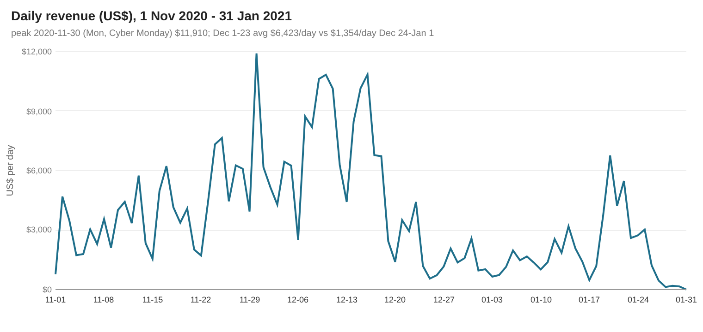 | 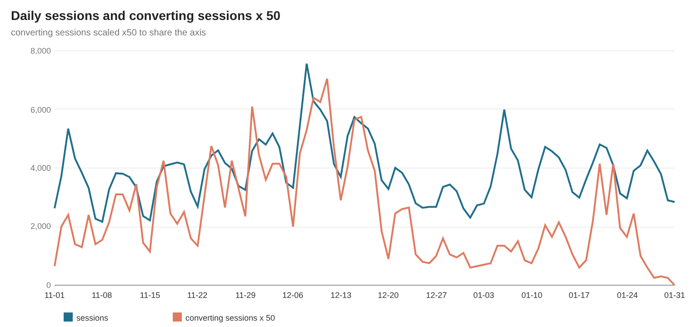 |
| 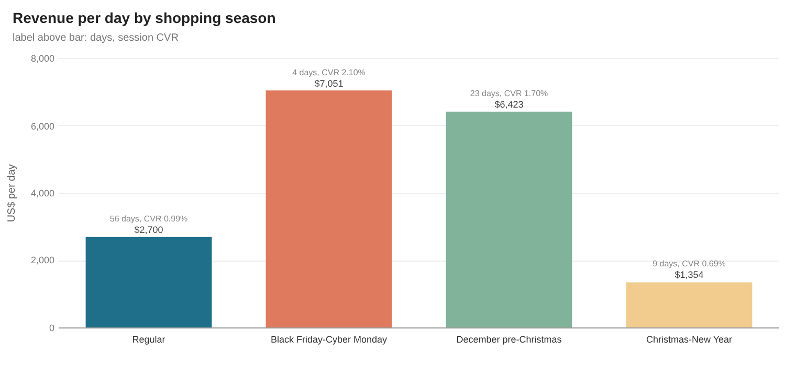 | 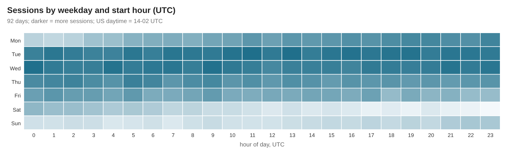 |
| 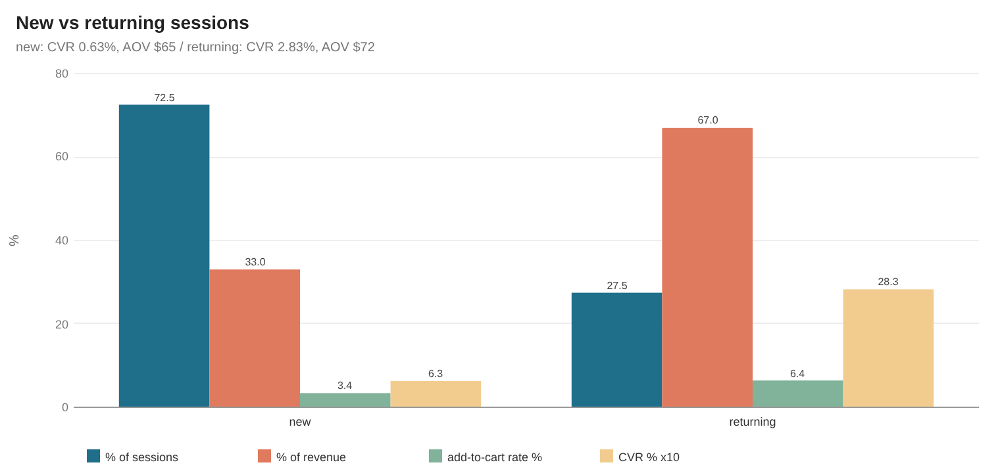 | 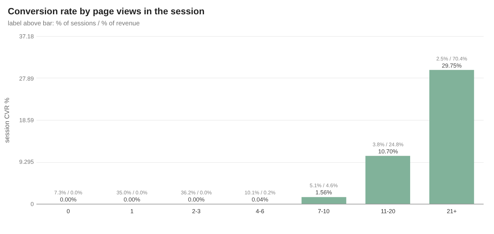 |
| 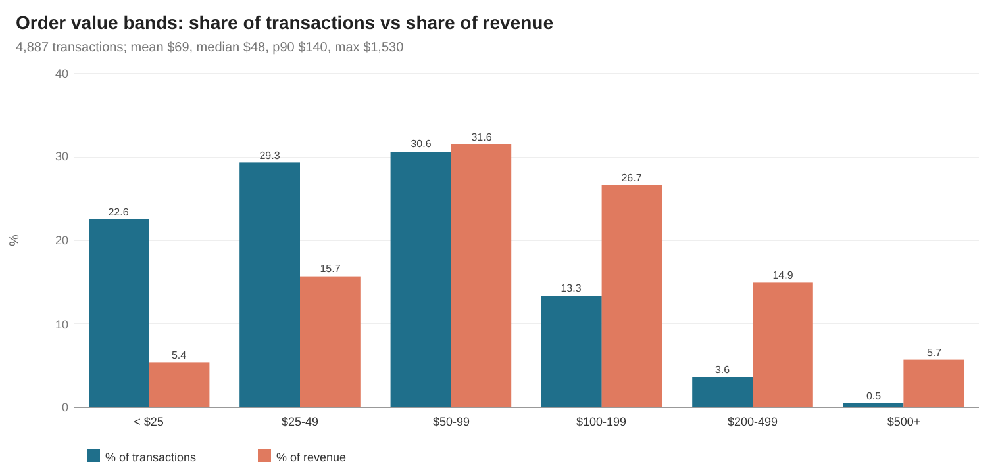 | 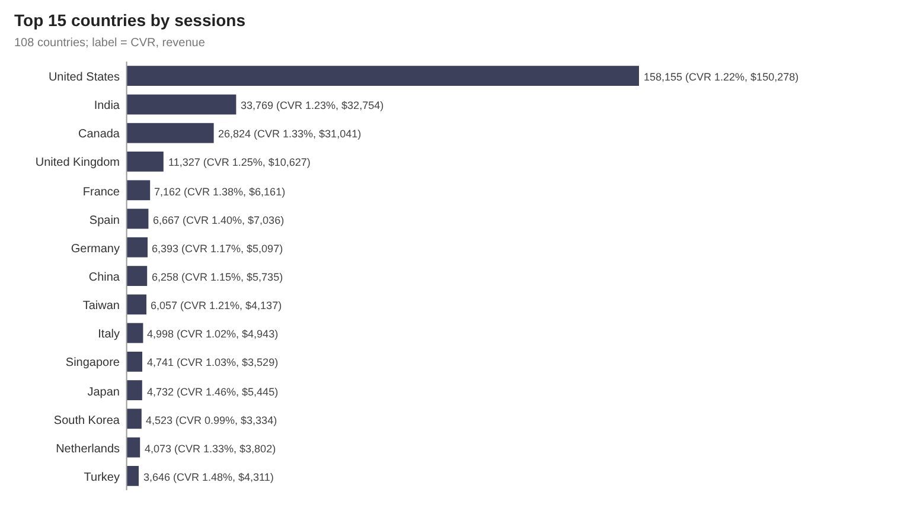 |
| 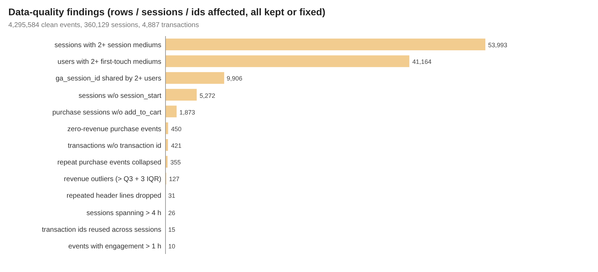 | |

**How the images were made:** `scripts/make_charts.py` reads the DuckDB query results exported to `results/tables/*.csv` and writes each chart as a plain-vector SVG with the small custom writer `scripts/svgcharts.py` (rect/line/polyline/circle/text only, no plotting library). `scripts/render_png.py` then rasterises every SVG to PNG at 2× with headless Google Chrome.

## How to run
```bash
pip install -r requirements.txt
python run_pipeline.py --source sample       # committed 322-user raw sample in data/raw/ (5.5 MB) -> results/sample/
python scripts/download_full_data.py         # 1.84 GB -> data/raw_full/ (pinned Hugging Face commit, SHA-256 checked)
python run_pipeline.py --source full         # full data (~20 s, needs ~6 GB RAM): results/, data/clean/, powerbi/data/, RESULTS.md
python scripts/render_png.py                 # results/images/*.svg -> *.png with headless Chrome
```
`scripts/make_sample.py` rebuilds the committed sample from the full file. The runner stops with an error if any assertion fails (28/28 pass on both the full data and the sample).

## Method notes
- **Session** = `user_pseudo_id` + `ga_session_id`. `ga_session_id` on its own is **not** unique in this export (9,906 ids are shared by 2+ users). Device, OS, country and first-touch source are constant within every session (asserted).
- **Engaged session** = any event with `session_engaged = '1'`. **Bounce rate = 1 − engagement rate** (the GA4 definition). **Conversion** = a session with at least one purchase with revenue > 0. **AOV** = revenue / transactions.
- **Funnel:** the *open* funnel counts sessions that fired each step event at least once, in any order. The *strict* funnel also requires every earlier step. 1,873 of 4,446 purchasing sessions have no `add_to_cart` event, which is an artefact of Google's obfuscation, so the open funnel is the headline.
- **Purchases:** 450 purchase events have revenue 0/NULL and are not counted as transactions. Repeated purchase events of the same transaction in the same session (confirmation reloads) collapse to one, which removes $22,822 of double counting ($362,165 → $339,343). 421 transactions have no or `(not set)` transaction id and are keyed by session + revenue. 15 transaction ids reused across different sessions are kept as separate orders.
- **Channels:** *first-touch* channel = the user's acquisition `traffic_source` (always present), grouped GA-style (organic → Organic Search, cpc → Paid Search, (direct)/(none) → Direct, own-domain referral → Self-referral, other referral → Referral). *Session channel* = the session-scoped `source`/`medium` event params, taken from the first event that carries them; 26.3% of sessions carry none. Google's obfuscation placeholders `<Other>` and `(data deleted)` are kept as their own values.
- **Time:** `event_date` equals the UTC date of `event_timestamp` (asserted), so all dates and hours are UTC. Season windows are fixed calendar windows (Black Friday-Cyber Monday 27-30 Nov, pre-Christmas 1-23 Dec, Christmas-New Year 24 Dec-1 Jan).
- **Outliers** are flagged, not deleted: 127 orders above Q3 + 3 IQR (15.6% of revenue), 26 sessions spanning more than 4 h, and 10 events with more than 1 h engagement time.

## Repo layout
```
data/raw/            deterministic 322-user sample of the raw export (12,466 rows, 5.5 MB); full file via scripts/download_full_data.py
data/clean/star/     cleaned star exports: full dims, fact_transaction and daily x device x channel aggregate; 1-in-20 fact_session sample
sql/                 00 DuckDB shims, 01 staging, 02 cleaning, 03 star model, 04 analysis, 05 quality checks
run_pipeline.py      DuckDB runner (sample | full)
scripts/             project config, downloader, sample builder, SVG chart writer, PNG renderer, RESULTS.md writer
results/             RESULTS.md, metrics.json, JSON.shot, tables/*.csv, images/*.svg + *.png (dashboard = overview), sample/
powerbi/             star CSVs (full aggregate + transactions, sampled sessions), measures.dax, model.md, dashboard_spec.md, BUILD_GUIDE.md
```

## Caveats
- **Obfuscated data.** Google obfuscated this sample and warns that "internal consistency of the dataset might be somewhat limited". Placeholders (`<Other>`, `(data deleted)`) hide 21% of the first-touch traffic values. Funnel events are sometimes missing (purchases without `add_to_cart`). Device and country splits look unusually uniform (engagement is about 89% everywhere). Treat cross-dimension differences as indicative.
- **Late-January tracking.** 25-31 Jan has 26,342 sessions but only 98 transactions, and 31 Jan has none. Traffic stays normal, so purchase tracking appears to tail off at the end of the sample. This drags January's CVR (0.71%) down.
- **Self-referrals** from the store's own domains (15.7% of sessions on the session source) would be excluded in a production GA4 setup. They are kept and labelled here.
- **No item-level data.** The flattened mirror removes the `items[]` arrays, so product and category revenue is out of scope. Landing page uses page titles instead.
- `engagement_time_msec` is missing on 43% of events and is counted as 0 in session sums, as GA4 does.

## Complete dataset
- **Source:** Google Analytics 4 **obfuscated sample e-commerce dataset** of the Google Merchandise Store (Google; BigQuery public dataset `bigquery-public-data.ga4_obfuscated_sample_ecommerce.events_*`, 92 daily tables, 2020-11-01 to 2021-01-31). Docs: https://developers.google.com/analytics/bigquery/web-ecommerce-demo-dataset.
- **Kaggle pages (copies of the same BigQuery source):** https://www.kaggle.com/datasets/pdaasha/ga4-obfuscated-sample-ecommerce-jan2021 (January 2021 subset) and https://www.kaggle.com/datasets/mexwell/google-merchandise-sales-data (curated events/items/users subset). This project uses the complete three-month export instead, through the mirror below, because no Kaggle API key is needed for it.
- **Mirror used (flattened, complete, 1:1 with source events):** Hugging Face dataset `gizdevans/ga4-bq-flattened-data`, https://huggingface.co/datasets/gizdevans/ga4-bq-flattened-data, pinned commit `29f8ceef9152ff23b9c5446f40c1fb7c059f34d5`. Direct file URL: https://huggingface.co/datasets/gizdevans/ga4-bq-flattened-data/resolve/29f8ceef9152ff23b9c5446f40c1fb7c059f34d5/full_flatten_data.csv. The flattening SQL (BigQuery `events_*` → 60 flat columns; `event_params` pivoted, `items[]` dropped) is at https://github.com/dgizdevans/ga4-bq-flatten.
- **Licence:** the Hugging Face mirror and the flattening code are published under the **MIT licence** by their author (D. Gizdevans). The underlying data is Google's public, obfuscated GA4 demo export, offered through the Google Cloud Public Datasets programme for learning and analysis. Check Google's terms before any commercial reuse. The Kaggle copies carry the licence shown on each Kaggle page.
- **Total size:** 1,844,623,697 B (1.84 GB), one CSV.
- **Files:**
  - `full_flatten_data.csv`: 1,844,623,697 B, 4,295,615 data rows (4,295,584 events + 31 repeated shard header lines) × 60 columns, 270,154 users, 360,129 sessions, 92 days. SHA-256 `f09b13d6d59f8fd72ef07095eb95085388fa873129961eb116fc0d20dc1e9012`. Columns are listed in [`data/README.md`](data/README.md).
- **Download:** `python scripts/download_full_data.py` (downloads the pinned mirror file into `data/raw_full/` and verifies SHA-256). Or: `curl -L -o data/raw_full/full_flatten_data.csv https://huggingface.co/datasets/gizdevans/ga4-bq-flattened-data/resolve/29f8ceef9152ff23b9c5446f40c1fb7c059f34d5/full_flatten_data.csv`
