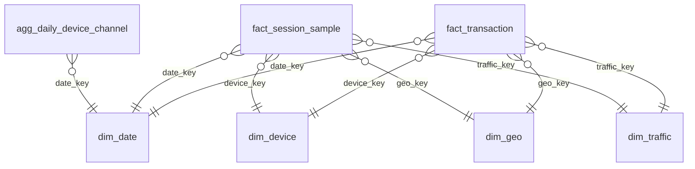

# Power BI model (star schema)

| Table | Grain | Rows in `powerbi/data/` | Full rows | Key |
|---|---|---|---|---|
| agg_daily_device_channel | day x device category x first-touch channel group: sessions, users, engaged sessions, funnel-step sessions, conversions, transactions, revenue | 1,924 (**full**) | 1,924 | (date_key, device_category, channel_group) |
| fact_session_sample | one GA4 session (user_pseudo_id + ga_session_id): funnel step flags, engagement, landing page, session source/medium, transactions, revenue | 18,006 (**1-in-20 sample**: session_key % 20 = 0) | 360,129 | session_key |
| fact_transaction | one de-duplicated transaction (purchase with revenue > 0) | 4,887 (**full**) | 4,887 | transaction_key |
| dim_date | calendar day 2020-11-01..2021-01-31, weekday, season window | 92 | 92 | date_key (yyyymmdd) |
| dim_device | device category x operating system x browser | 49 | 49 | device_key |
| dim_geo | continent x sub-continent x country | 122 | 122 | geo_key |
| dim_traffic | first-touch source x medium x campaign + channel_group | 15 | 15 | traffic_key |

**Why two session tables:** the full session fact (360,129 rows, about 77 MB as CSV) is too big for a git repo, so headline KPIs, the funnel and the device/channel/day views are built on the **full** `agg_daily_device_channel` (exact totals). `fact_session_sample` is used for drill-downs the aggregate cannot answer, such as landing page, new vs returning, page depth and session source/medium. Visuals built on it show *sample* values (1 in 20 sessions). To get full values, run `python run_pipeline.py --source full` and point Power Query at a full export of `fact_session` (edit `scripts/project.py`).

Relationships: all many-to-one and single direction (the dimension filters the fact). `agg_daily_device_channel` relates only to `dim_date`; its `device_category` and `channel_group` are plain text columns (slice them with columns from that table, not from dim_device / dim_traffic).

Fact columns worth knowing:
- `is_engaged` / `is_bounce` (complements: GA4 bounce = not engaged), `is_converted` (>= 1 valid transaction), `has_*` funnel-step flags (0/1), `user_type` (new = ga_session_number 1).
- `session_channel` = session-scoped source/medium event params grouped like `dim_traffic[channel_group]` (`(not set)` when the session carries none).
- `revenue_usd` is the de-duplicated transaction revenue in US$; `dq_*` are quality flags (kept rows, never deleted).
- `start_hour_utc` and all dates are **UTC**.
